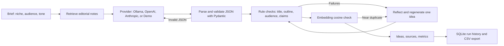

# Blog Idea Generator

Turn a niche and audience into distinct, structured, quality-checked blog briefs — not just a list of titles.

## Demo and screenshots

The app is live at **[blog-idea-generator-0qap.onrender.com](https://blog-idea-generator-0qap.onrender.com/)** and currently runs in **Demo mode** without API keys; model-generated results require a configured provider. A recorded 30–60 second GIF and real screenshots have not been captured yet. Add them under `docs/assets/` after recording the full local flow; do not present the deterministic Demo output as live LLM output.

## Run locally

```bash
python3 -m venv .venv
source .venv/bin/activate
pip install -r requirements.txt
cp .env.example .env
uvicorn main:app --reload --port 8001
```

Open http://127.0.0.1:8001. The app defaults to automatic provider selection: Anthropic, OpenAI, a reachable local Ollama service, then Demo mode. To force offline mode, set `LLM_PROVIDER=demo`. For Ollama, install and start Ollama and pull a chat model; for duplicate embeddings, also pull the model named by `OLLAMA_EMBED_MODEL` (defaults to `nomic-embed-text`). Set API keys in the environment or a locally managed `.env`; `.env` is ignored by Git.

Supported provider values: `auto`, `demo`, `ollama`, `openai`, `anthropic`. Select a model with `LLM_MODEL`. `OPENAI_API_KEY` and `ANTHROPIC_API_KEY` are only read by their respective providers.

## Pipeline



## Quality checks and evaluation

Each idea contains a title, hook, angle, target keyword, search intent, audience, estimated word count, format, and outline sections with summaries. Pydantic validates the output shape. Code checks title length, intro/body/conclusion structure, promised numbered items, niche and audience fit, promotional claims, and unsupported statistics. Failed ideas receive targeted retries; the best available attempt is returned with any unresolved warnings visible.

Ollama embeddings are used when the embedding endpoint is available. Other providers, or Ollama without an embedding model, use local lexical cosine similarity as a no-extra-dependency fallback. Similarity is a heuristic, not a guarantee of semantic uniqueness.

Run unit and API tests:

```bash
python -m pytest -q
```

Run the 15-niche evaluation in offline Demo mode:

```bash
python scripts/evaluate.py
```

The script refreshes [docs/evaluation.md](docs/evaluation.md). Opt into model calls with `--provider ollama`, `--provider openai`, or `--provider anthropic`; configure credentials first. Live model cost is explicitly reported as not measured because token usage and pricing are not collected. Demo metrics test the deterministic pipeline only; they are not a model-quality claim.

Generation history, including the structured ideas and validation results, and aggregate quality metrics are stored in SQLite at `data/history.sqlite3` by default. Aggregate pass rate, duplicate rate, and latency are available at `/metrics`, with a breakdown by provider/model and tone; individual run history is not exposed there. Configure a private `HISTORY_EXPORT_TOKEN` to enable the UI's CSV export at `/history.csv`; the export requires that token and is disabled when unset. Set `DATABASE_PATH` to persist the database outside the container when deploying.

## Deployment

Build and run locally with Docker:

```bash
docker build -t blog-idea-generator .
docker run --rm -p 8001:8001 blog-idea-generator
```

For Render, use the included Blueprint at [render.yaml](./render.yaml), or use build command `pip install -r requirements.txt` and start command `uvicorn main:app --host 0.0.0.0 --port $PORT`. The Blueprint uses Demo mode so it runs without API keys. Ollama is not included in the web service. SQLite on an ephemeral filesystem is not durable across redeploys; use a persistent disk and set `DATABASE_PATH` if run history must persist.

## Known limitations

- The built-in Demo provider is deterministic sample data and does not call an LLM.
- The small grounding set contains editorial guidance, not niche-specific research or live keyword-volume data. Sources are displayed in the UI so they are not misrepresented as external factual citations.
- Embeddings depend on Ollama's embedding endpoint and an installed embedding model; lexical cosine fallback can miss paraphrases.
- Validation is rule-based and cannot prove factual accuracy, guarantee SEO performance, or ensure every generated idea is useful. Review model-generated claims before publishing.
- There is no semantic response cache or daily per-user request cap. Per-IP rate limiting is in-process and resets on restart; use a shared limiter for multi-instance deployment.
- Provider token usage/cost, authentication, durable hosted analytics, screenshots, and the demo GIF are not currently included.

## Project files

- `main.py` — FastAPI routes, per-IP rate limit, metrics, and CSV export.
- `idea_engine.py` — providers, structured generation, validation, reflection, and duplicate checks.
- `knowledge_base.py` — small retrievable editorial knowledge base.
- `run_history.py` — SQLite persistence and aggregate metrics.
- `tests/` — validator, provider, API, history, and UX coverage.
