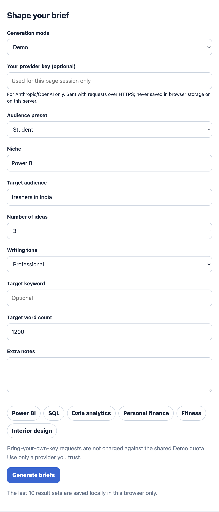
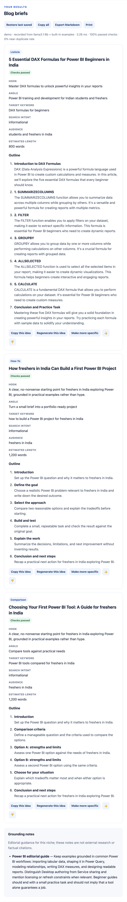
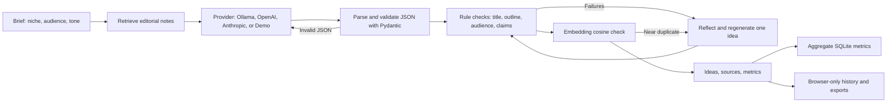

# Blog Idea Generator

Turn a niche and audience into distinct, structured, quality-checked blog briefs — not just a list of titles.

## Demo and screenshots

The app is live at **[blog-idea-generator-0qap.onrender.com](https://blog-idea-generator-0qap.onrender.com/)** and currently runs in **Demo mode** without API keys. Demo mode uses pre-recorded local `llama3.1:8b` samples for supported niches, with the source shown in the result mode, plus built-in examples for other formats and niches. Screenshots below are from the local Demo app; a 30–60 second screen-recorded GIF remains to be captured.






## Evaluation snapshot

| Provider | Niches | Ideas | Validation pass rate | Near-duplicate rate | Avg latency | Cost |
|---|---:|---:|---:|---:|---:|---:|
| Offline Demo | 15 | 45 | 100% | 0% | 0.38 ms | $0.00 |

This is a deterministic pipeline smoke evaluation, not an LLM quality benchmark. See the [per-niche results](docs/evaluation.md) and [architecture notes](docs/architecture.md).

## Run locally

```bash
python3 -m venv .venv
source .venv/bin/activate
pip install -r requirements.txt
cp .env.example .env
uvicorn main:app --reload --port 8001
```

Open http://127.0.0.1:8001. The app defaults to Demo mode. For Ollama, install and start Ollama and pull a chat model; for duplicate embeddings, also pull the model named by `OLLAMA_EMBED_MODEL` (defaults to `nomic-embed-text`). Set API keys in the environment or a locally managed `.env`; `.env` is ignored by Git. The UI also supports transient OpenAI or Anthropic keys: they remain in page memory, are sent only with a request, and must use HTTPS outside localhost.

Supported provider values: `demo`, `ollama`, `openai`, `anthropic`, and `auto` for explicit environment-based auto-selection. Select a model with `LLM_MODEL`. `OPENAI_API_KEY` and `ANTHROPIC_API_KEY` are only read by their respective providers. Shared Demo runs have a configurable global daily cap; BYOK calls do not use that quota.

## Pipeline



## Quality checks and evaluation

Each idea contains a title, hook, angle, target keyword, search intent, audience, estimated word count, format, and outline sections with summaries. Pydantic validates the output shape. Code checks title length, intro/body/conclusion structure, promised numbered items, niche and audience fit, promotional claims, and unsupported statistics. Failed ideas receive targeted retries; the best available attempt is returned with any unresolved warnings visible.

Ollama embeddings are used when the embedding endpoint is available. Other providers, or Ollama without an embedding model, use local lexical cosine similarity as a no-extra-dependency fallback. Similarity is a heuristic, not a guarantee of semantic uniqueness.

Run unit and API tests:

```bash
python -m pytest -q
```

Run the 15-niche evaluation in offline Demo mode:

```bash
python scripts/evaluate.py
```

The script refreshes [docs/evaluation.md](docs/evaluation.md). Opt into model calls with `--provider ollama`, `--provider openai`, or `--provider anthropic`; configure credentials first. Live model cost is explicitly reported as not measured because token usage and pricing are not collected. Demo metrics test the deterministic pipeline only; they are not a model-quality claim.

Only aggregate run metrics, the shared Demo quota, and anonymous vote counts are stored in SQLite at `data/history.sqlite3` by default. Prompts, generated ideas, IP addresses, and provider keys are not stored. A user's optional browser history is stored locally in that browser and can be cleared there. Aggregate pass rate, duplicate rate, latency, and mode breakdown are available at `/metrics`. Set `DATABASE_PATH` to persist aggregate metrics outside the container when deploying.

## Deployment

Build and run locally with Docker:

```bash
docker build -t blog-idea-generator .
docker run --rm -p 8001:8001 blog-idea-generator
```

For Render, use the included Blueprint at [render.yaml](./render.yaml), or use build command `pip install -r requirements.txt` and start command `uvicorn main:app --host 0.0.0.0 --port $PORT`. The Blueprint uses Demo mode so it runs without API keys. Ollama is not included in the web service. SQLite on an ephemeral filesystem is not durable across redeploys; use a persistent disk and set `DATABASE_PATH` if run history must persist.

## Known limitations

- Demo replays saved samples and deterministic built-in examples; it does not call a live LLM.
- Demo includes eight saved model outputs, labelled as recorded from `llama3.1:8b`; they are not live generations. A recording helper is available at `python -m scripts.record_demo` for a local Ollama installation.
- Only four of the eight raw Llama recordings currently pass every validator; the other four remain visibly flagged in Demo rather than being silently rewritten. These recordings are examples, not evidence that the provider meets the 100% Demo smoke-test pass rate.
- The bundled niche notes cover Power BI, SQL, data analytics, personal finance, fitness, and interior design. They are editorial guidance, not external research or live keyword-volume data; unsupported niches receive a labelled generic fallback.
- Embeddings depend on Ollama's embedding endpoint and an installed embedding model; lexical cosine fallback can miss paraphrases.
- Validation is rule-based and cannot prove factual accuracy, guarantee SEO performance, or ensure every generated idea is useful. Review model-generated claims before publishing.
- There is no semantic response cache or daily per-user request cap. The shared Demo quota is global to the SQLite database. Per-IP rate limiting is in-process and resets on restart; use a shared limiter for multi-instance deployment.
- Provider token usage/cost, authentication, durable hosted analytics, and the demo GIF are not currently included. Screenshots show the local Demo app, not the live deployment.

## Project files

- `main.py` — FastAPI routes, per-IP rate limit, metrics, and shared Demo quota.
- `idea_engine.py` — providers, structured generation, validation, reflection, and duplicate checks.
- `knowledge_base.py` — small retrievable editorial knowledge base.
- `knowledge/` — niche-specific writing constraints plus the labelled generic fallback.
- `run_history.py` — SQLite persistence and aggregate metrics.
- `tests/` — validator, provider, API, history, and UX coverage.
