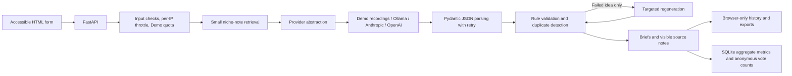

# Architecture

## Data boundaries

- BYOK credentials are held in page memory, transmitted in a request header over HTTPS, and passed directly to the selected provider. They are not written to browser storage, SQLite, or application logs.
- Brief inputs and generated ideas are not stored on the server. The browser may retain up to ten result sets in local storage; users can clear that history.
- SQLite stores daily Demo usage, aggregate pass/duplicate/latency metrics, and anonymous daily vote counts. Existing detailed server-side run history is migrated to metric-only records and removed.
- IP addresses are used transiently by the in-process rate limiter; they are not persisted.

## Quality pipeline

The engine retrieves a niche-specific editorial note or labelled generic fallback, asks a provider for structured JSON, validates the Pydantic model, and applies code checks. Failed ideas are retried individually. Exact repeated target keywords and high-similarity briefs are also retried; unresolved problems remain visible as validation warnings.

Demo mode replays genuine local `llama3.1:8b` recordings for eight niches when the request matches the recorded audience and tone. Other formats and unmatched niches use deterministic built-in examples. The result's model label distinguishes a recorded sample from a live provider call.
